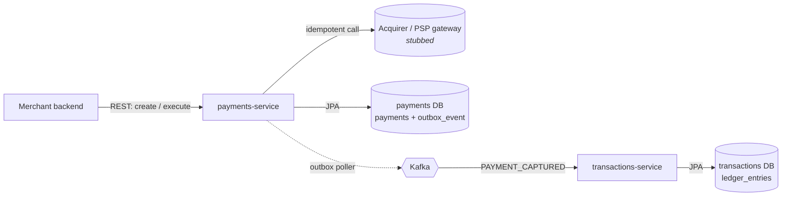
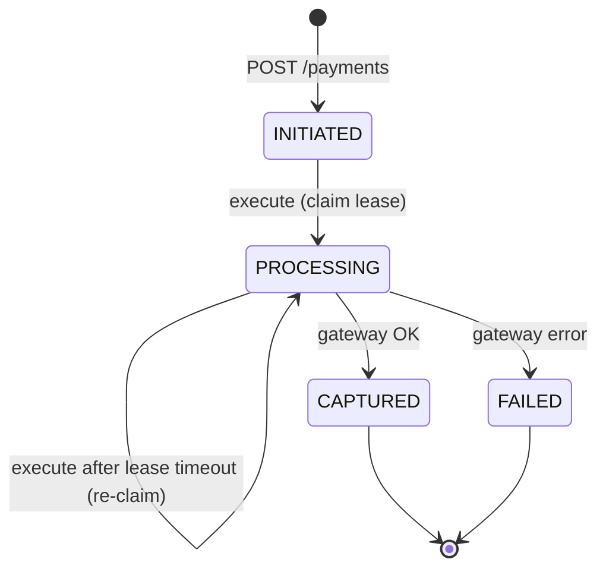
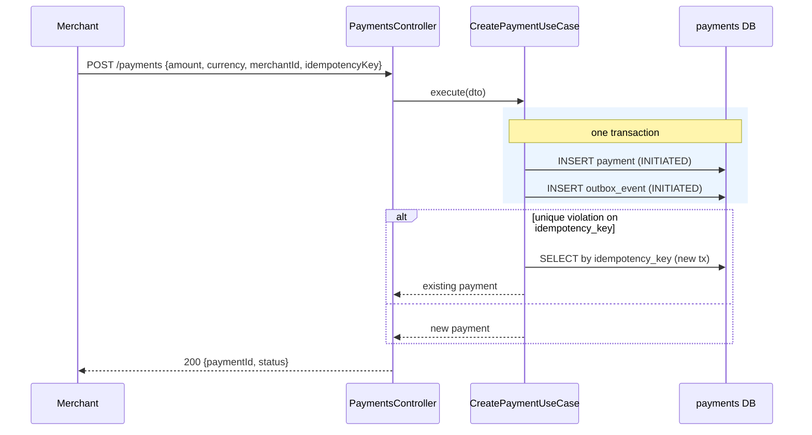
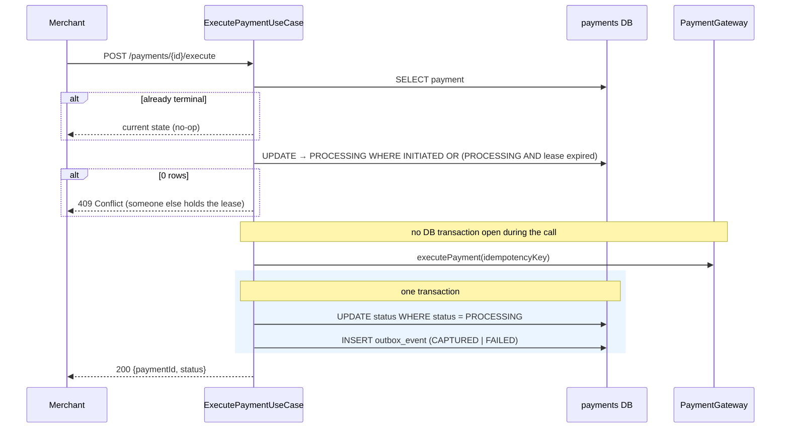
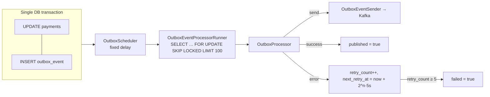

# Architecture

This document describes the system **as it is today**: its modules, its layering, and the key reliability mechanisms. Design rationale lives in [`adr/`](adr). Known gaps are in [CODE_REVIEW.md](CODE_REVIEW.md), and future direction is in [ROADMAP.md](ROADMAP.md).

## 1. System context



- **Database per service.** Each service owns its schema. There are no cross-service joins and no distributed transactions.
- **Synchronous edge, asynchronous core.** Merchants talk REST to `payments-service`. Downstream services react to events.

## 2. Modules

| Module | Type | Responsibility |
|---|---|---|
| `payments-service` | Spring Boot app | Payment lifecycle (create, execute), state machine, gateway orchestration, writing outbox events |
| `transactions-service` | Spring Boot app | Consumes payment events and records immutable ledger entries |
| `messaging-outbox-core` | Plain Java lib | Framework-free outbox model (`OutboxRecord`) and delivery/retry logic (`OutboxProcessor`) |
| `messaging-outbox-spring-jpa` | Spring lib | JPA entity, `SKIP LOCKED` polling repository, transactional runner and scheduler for the outbox |
| `messaging-events-core` | Plain Java + Kafka lib | Shared `EventEnvelope`, `EventType`, Kafka JSON (de)serializers |

Dependency direction: apps → libs. The libs never depend on apps, and `*-core` libs never depend on Spring.

## 3. Layering inside a service (clean / hexagonal)

```
adapters/
  inbound/   controllers, Kafka consumers      → call application use cases
  outbound/  Kafka sender, …                   → implement application ports
application/ use cases + ports (PaymentGateway, EventMessagePublisher) + DTOs
domain/      entities, status enums, transition rules, repository interfaces
infrastructure/ framework config, port implementations (gateway client, outbox publisher)
```

Rules:
- Use cases are the transaction boundary. Controllers and consumers only map and delegate.
- Use cases depend on **ports** (interfaces), never on Kafka, HTTP clients or the outbox library directly.
- Pragmatic exception: domain entities are JPA-annotated, and repositories extend Spring Data. This trades purity for less mapping code. See [CODE_REVIEW §19](CODE_REVIEW.md#19-clean-architecture-leaks).

## 4. Payment lifecycle



- Transitions are resolved by `PaymentActionResolver` from `PaymentActionStrategy` implementations.
- Every transition is persisted with a **conditional update** (`WHERE status = :expected`). Concurrent writers cannot overwrite each other.
- `CAPTURED` and `FAILED` are terminal.

## 5. Request flows

### 5.1 Create payment (idempotent)



The DB unique constraint *is* the lock: there is no check-then-insert race. The insert runs in a narrow `TransactionTemplate`, so the fallback read happens in a clean transaction.

### 5.2 Execute payment



Key decisions:
- **No DB transaction spans the external call.** The `PROCESSING` status plus `processing_started_at` act as a lease-based distributed lock instead. See [ADR-0003](adr/0003-lease-based-processing-lock.md).
- The gateway call carries an idempotency key, so a retry after a crash or lease expiry cannot double-charge.

## 6. Transactional outbox



- **Guarantee:** at-least-once delivery. An event is never lost if its state change is committed. Consumers **must** be idempotent.
- `SKIP LOCKED` lets several instances poll concurrently without processing the same row.
- The core retry logic (`messaging-outbox-core`) is framework-free. Spring/JPA wiring lives in `messaging-outbox-spring-jpa`.

See [ADR-0001](adr/0001-transactional-outbox.md).

## 7. Event contract

Events are wrapped in a common envelope (`messaging-events-core`):

```jsonc
{
  "eventId": "6f1c…",            // consumer idempotency key
  "eventType": "PAYMENT_CAPTURED",
  "payload": { "paymentId": 42, "amount": 10.00, "currency": "EUR", "occurredAt": "…" },
  "occurredAt": "2026-10-31T12:00:00Z"
}
```

- Consumers subclass `AbstractEventEnvelopeDeserializer` and register only the event types they handle.
- `transactions-service` consumes `PAYMENT_CAPTURED` and writes one `ledger_entries` row. It dedups on a unique `event_id`.

> ⚠️ The producer side does not yet emit this envelope. See [CODE_REVIEW §2](CODE_REVIEW.md#2-producer-and-consumer-event-contracts-do-not-match-and-nothing-sends-events).

## 8. Idempotency and concurrency summary

| Concern | Mechanism | Where |
|---|---|---|
| Duplicate create | Unique `idempotency_key` + catch-and-return | `CreatePaymentUseCase`, `payments` table |
| Concurrent execute | Conditional `claimProcessingStatus` lease | `PaymentRepository` |
| Crashed executor | Lease timeout (`service.processing-status-timeout-seconds`) | `ExecutePaymentUseCase` |
| Double charge on retry | Idempotency key forwarded to gateway | `PaymentGateway` |
| Lost-update on status | `UPDATE … WHERE status = :current` | `PaymentRepository` |
| Lost event | Outbox in the same tx as the state change | `OutboxEventPublisher` |
| Duplicate event delivery | Unique `event_id` in the ledger | `ProcessLedgerEntryUseCase` |
| Multi-instance outbox polling | `FOR UPDATE SKIP LOCKED` | `OutboxEventRepository` |

## 9. Runtime and ops

- **Ports:** app on `8080` (context path `/payments-service`, `/transactions-service`) and management on `8081` (`/<service>/private/{health,metrics}`).
- **Schema:** Liquibase changelogs under `src/main/resources/db/changelog`.
- **Images:** distroless Java 25, built from the pre-built `build/libs/service.jar`.
- **CI:** GitHub Actions builds, tests and enforces JaCoCo thresholds. It publishes JUnit and JaCoCo reports to GitHub Pages and comments coverage on PRs.

## 10. Testing strategy

| Level | Scope | Tooling |
|---|---|---|
| Unit | Domain strategies, use cases, outbox core, (de)serializers | JUnit 5, Mockito, AssertJ |
| Component | Full Spring context over HTTP / Kafka, with real DB schema | `@SpringBootTest`, MockMvc, EmbeddedKafka, H2 |
| Coverage gate | Instruction / line / branch / complexity thresholds | JaCoCo (`gradle/jacoco.gradle`) |

The planned next step is Testcontainers (Postgres + Kafka) and contract tests. See [CODE_REVIEW §15](CODE_REVIEW.md#15-tests-run-on-h2-while-production-is-postgres).
